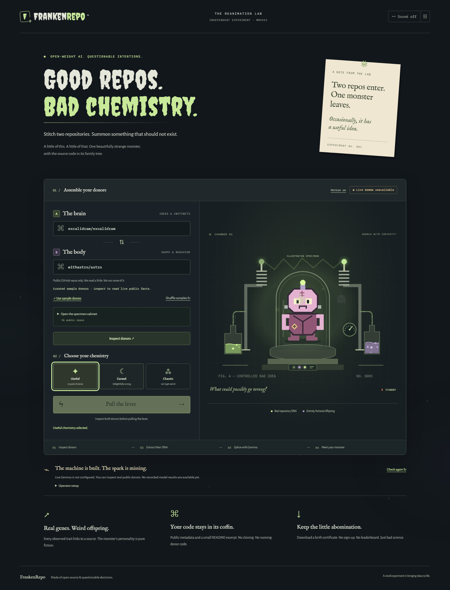

# FrankenRepo

_Stitch two repositories. Summon something that should not exist._

**Latest tagged release: v0.1.0. Source integration update: 1 November 2026.**
[Source](https://github.com/drevendev/FrankenRepo) ·
[Releases](https://github.com/drevendev/FrankenRepo/releases) ·
[Known issues](docs/KNOWN_ISSUES.md) ·
[GitHub CI](https://github.com/drevendev/FrankenRepo/actions/workflows/ci.yml)

## Post-deadline source update — 1 November 2026

The challenge deadline was **31 October 2026, 23:59 PDT**
(1 November, 06:59 UTC / 08:59 Asia/Nicosia). **All commits introduced by this
source update are after that deadline.** They publish previously local work and
include subsequent documentation and publication changes. They are not the
public repository state at the submission deadline.
The [previous public snapshot](https://github.com/drevendev/FrankenRepo/tree/6729a4efd7b1594f186d513bdf513645ce9609bb)
and existing `v0.1.0` tag are preserved.

The post-deadline source update includes:

- MongoDB private recovery, consented sharing/removal, durable jobs, idempotency,
  budget reservations and signed guest sessions.
- Mastra workflows, metadata-only Sentry tracing, optional Ultramarine second
  opinions and frozen-snapshot Gemma revisions; prompt v6 and regression guards.
- Browserbase research/operator scripts, bounded Backboard memory tooling and
  a proposed Tinker pilot. Memory-corpus approval and actual training remain
  deferred; including proposal files does not approve or run them.
- Tests, setup documentation, dated successes/failures, the real 52-second local
  demo and the authorized Sentry screenshot used in the published article.
  The Render Free blueprint is prepared; no application has been deployed.

The [DEV article](https://dev.to/drevendev/i-gave-two-github-repositories-a-terrible-idea-then-i-gave-it-life-1ge9)
and its first five category entries were published before the deadline. Its
Sentry screenshot and sixth category entry were added afterward and labelled
as a post-submission update. Earlier dates on local run receipts describe those
runs, not the publication time of these commits. The
[publication record](docs/submission/PUBLISHED.json) and
[category review](docs/submission/CATEGORY_REVIEW.json) retain this distinction;
organizer acceptance of the late addition is unconfirmed.

A small gothic browser laboratory: inspect two public GitHub repositories, use
a configured Gemma model to invent a fictional creature, then download its
Monster Birth Certificate. Observed facts stay linked to their sources.
The creature is an imaginative interpretation, not a judgment of a project.

**First real Gemma ritual verified locally on 28 October 2026 (Asia/Nicosia).**
Cloudflare Gemma generated a schema-valid creature from pallets/flask and jqlang/jq
through the actual browser/API, with PNG/SVG export. [Live receipt and result](docs/eval/REAL_RUNS.md).
Without configured credentials the default model remains disabled. Persistent
gallery and public application hosting are not supplied. This source update now
adds an optional MongoDB private archive, durable budgets, Mastra workflows,
metadata-only Sentry traces and opt-in second opinions/revisions.
[Current implementation, real receipts and deferred work](docs/partners/UPDATE_RESULT_RU.md).
This source snapshot publishes the implementation described in the article,
tests, original assets and sanitized real-run evidence. It is separate from
the existing tagged preview and from application hosting.



The creature above is an illustrated specimen, not model output.
[Mobile capture](docs/images/lab-mobile.png).
[Actual live GitHub inspection](docs/images/inspection-live-desktop.png).

New real pair runs: HungryCrab + desktop-fly (Chaotic) and Scriptorium +
ex-ussr-kinship-research (Useful). See the [inheritance review](docs/eval/PAIR_REVIEW_2026-10-28.md),
[article/demo selection](docs/submission/EDITORIAL_SELECTION.md) and
[local card contact sheet](docs/submission/CARD_CONTACT_SHEET.html).
The review distinguishes memorable characters from unsupported technical ideas.

## First run

The lab starts with two distinct random donors from a 16-repository cabinet.
Use the cabinet to choose Dreven projects, both DenisSergeevitch guests or community
favorites, or type any public GitHub reference. Shuffle avoids repeating the last pair.
Selecting samples never starts inspection or inference.

Use Node **24** and npm **11**:

```sh
git clone https://github.com/drevendev/FrankenRepo.git
cd FrankenRepo
npm ci
npm run dev
```

Open **http://127.0.0.1:5173**. Choose **Use sample donors**, then **Inspect donors**.
This makes real anonymous GitHub API calls; network access and GitHub quota are
required. Swap donors or enter another public owner/repo pair.
A missing model never produces a fabricated creature.

For a production build served locally on **http://127.0.0.1:3001**:

```sh
npm run build
npm start
```

No accounts, keys or model downloads are needed to open the UI. Optional sound
starts off. Only the model-generated certificate offers PNG, SVG and alt-text
exports. Test fixture output is confined to tests.

Click **Sound on** for the quiet original music box, organ drone and laboratory
effects. **Audio settings** controls volume and music separately. Audio pauses
when the tab is hidden. **Motion off** pauses decorative animation; system
reduced-motion is respected. Changing mode adds a brief reagent/sigil pulse.
Creepster, IM Fell English, Alegreya Sans and IBM Plex Mono are self-hosted OFL fonts. Liquid, lights and the resident ghost are visual
atmosphere and never stand in for an actual API stage.

## Enable real local Gemma

Any live provider now requires `MONGODB_URI`, `MONGODB_DB` and a stable random
`SESSION_SECRET` of at least 43 characters. Durable reservations must succeed
before inference. Keep the secret between restarts; recovery capabilities remain
private. The ordinary disabled-model UI still needs no account. See
[storage/security boundaries](docs/ARCHITECTURE.md) and the
[current deployment handoff](docs/DEPLOYMENT.md).

For the public contest demo, the selected primary target is
[Cloudflare-hosted Gemma 4 26B A4B IT](docs/MODEL_DECISION.md). Its public Free-plan
eligibility was checked; dated real runs include Cursed (v1), Useful/Chaotic (v3),
a Chaotic v4 repeat, and v6 Chaotic/Cursed. Useful v6 was rejected after its
bounded repair; it is not a successful current-mode qualification. The
[1 November recorded Cursed run](docs/submission/DEMO_REAL_RECEIPT.json)
uses the actual v6 provider flow. The local Ollama adapter below is an
unqualified fallback, not a demonstrated equivalent model.

For the recommended setup, follow the
[step-by-step Cloudflare Free guide in Russian](docs/CLOUDFLARE_SETUP_RU.md):
account, scoped token, local .env, first ritual and actual run receipt.

1. Install/start Ollama separately and explicitly select/download a Gemma model
   appropriate for your machine. FrankenRepo never downloads weights itself.
2. Copy .env.example to .env. Set MODEL_PROVIDER=ollama and OLLAMA_MODEL to the
   exact installed model name (example: gemma3:4b). Leave the loopback base URL.
3. Restart the API, select donors, inspect, and pull the lever.
4. Capture actual model evidence:

```sh
npm run test:live -- pallets/flask jqlang/jq cursed
```

Repeat with useful and chaotic when the first call succeeds. Receipts go under
docs/eval/runs/ and include actual model, installed digest, input pair, timings
and result/failure. Review humor and recognizability manually; schema validity
does not establish creative quality. See [real-run status](docs/eval/REAL_RUNS.md).

The Cloudflare adapter completed its first authorized local browser ritual.
Only use an explicitly authorized account with confirmed free/no-card access:
set MODEL_PROVIDER=cloudflare, CF_ACCOUNT_ID, CF_API_TOKEN and the exact
CF_GEMMA_MODEL. Dated real runs in all three modes are recorded; wider quality, quota and hosted access remain
unverified. No credentials are bundled or read from other projects.

## What is implemented

| Area          | Current behavior                                                                                                                                                    |
| ------------- | ------------------------------------------------------------------------------------------------------------------------------------------------------------------- |
| GitHub        | Strict reference parser, fixed public REST endpoints, max four calls/donor, size/time caps, ETag + bounded cache, source links, honest missing data                 |
| Model         | Disabled / Ollama / Cloudflare, server-only, strict JSON + evidence validation, durable daily reservations, one repair or deliberate revision                       |
| Game          | Three prompt styles, deterministic original layered SVG, reveal/skip, muted synthesized sound, responsive keyboard/reduced-motion UI                                |
| Certificate   | Source-aware traits, first words, speculative useful mutation, PNG/SVG + alt text + copied share text                                                               |
| Jobs          | Mastra or legacy stages, Mongo idempotency/budgets, signed browser sessions, global concurrency cap and 24h durable job TTL                                         |
| Persistence   | Optional private Mongo archive and recovery files; separately consented public read/unpublish/delete behind a default-off flag; gallery disabled                    |
| Partners      | Live Mastra, Atlas, Sentry, Ultramarine and Browserbase research receipts; Backboard corpus and Tinker training await owner review                                  |
| Qualification | Six scoped local scenarios reviewed for the article; current v6 Useful rejected a safety violation; Sentry category added after deadline; public hosting unverified |

[Useful/Chaotic output and inheritance review](docs/eval/INHERITANCE_REVIEW.md)
compares six real runs across prompt revisions and keeps the weak examples too.

## Verification

```sh
npm run verify
npx playwright install chromium
npm run test:e2e
```

Browser tests use explicit test provider fixtures for the success path and
must not be described as real Gemma runs. Screenshots show the actual default UI.
[Validation results](docs/VALIDATION.md) · [architecture](docs/ARCHITECTURE.md) ·
[security](docs/THREAT_MODEL.md) · [deployment handoff](docs/DEPLOYMENT.md) ·
[partner status](docs/partners/STATUS.json) · [published article source](docs/submission/DEV_DRAFT.md).

This is a local-first preview. Model text and reviews can still invent unsupported capabilities.
Mongo guards do not establish exactly-once provider billing or guarantee semantic truth.
See the [tracked issues](docs/KNOWN_ISSUES.md) before hosting or relying on
a proposed mutation. Source publication was authorized separately after the
deadline; no application deployment, new release or new paid service is part of
this update. [31 October observed credit usage](docs/eval/PARTNER_QUALIFICATION_ROLLUP.json)
and [1 November demo usage](docs/submission/DEMO_REAL_USAGE.json).

MIT source. Dependencies/model terms are separate. [Credits](ASSETS_CREDITS.md).
