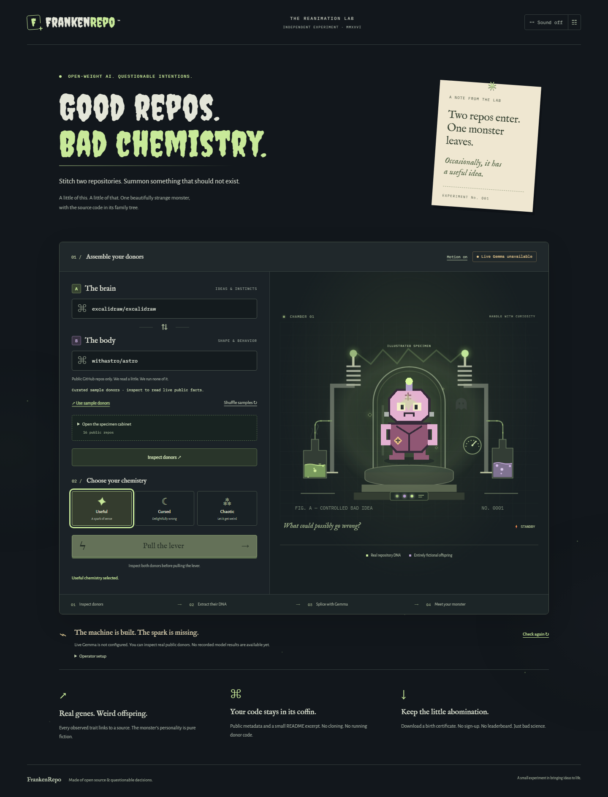

# FrankenRepo

_Stitch two repositories. Summon something that should not exist._

A small gothic browser laboratory: inspect two public GitHub repositories, use
a configured Gemma model to invent a fictional creature, then download its
Monster Birth Certificate. Observed facts stay linked to their sources.
The creature is an imaginative interpretation, not a judgment of a project.

**First real Gemma ritual verified locally on 28 October 2026 (Asia/Nicosia).**
Cloudflare Gemma generated a schema-valid creature from pallets/flask and jqlang/jq
through the actual browser/API, with PNG/SVG export. [Live receipt and result](docs/eval/REAL_RUNS.md).
Without configured credentials the default model remains disabled. Persistent
gallery, public repository and deployment are not supplied.



The creature above is an illustrated specimen, not model output.
[Mobile capture](docs/images/lab-mobile.png).
[Actual live GitHub inspection](docs/images/inspection-live-desktop.png).

New real pair runs: HungryCrab + desktop-fly (Chaotic) and Scriptorium +
ex-ussr-kinship-research (Useful). See the [inheritance review](docs/eval/PAIR_REVIEW_2026-10-28.md),
[article/demo selection](docs/submission/EDITORIAL_SELECTION.md) and
[local card contact sheet](docs/submission/CARD_CONTACT_SHEET.html).
The review distinguishes memorable characters from unsupported technical ideas.

## First run

The lab starts with two distinct random donors from a 16-repository cabinet.
Use the cabinet to choose Dreven projects, both DenisSergeevitch guests or community
favorites, or type any public GitHub reference. Shuffle avoids repeating the last pair.
Selecting samples never starts inspection or inference.

Use Node **24** and npm **11**. In this project directory:

```sh
npm ci
npm run dev
```

Open **http://127.0.0.1:5173**. Choose **Use sample donors**, then **Inspect donors**.
This makes real anonymous GitHub API calls; network access and GitHub quota are
required. Swap donors or enter another public owner/repo pair.
A missing model never produces a fabricated creature.

For a production build served locally on **http://127.0.0.1:3001**:

```sh
npm run build
npm start
```

No accounts, keys or model downloads are needed to open the UI. Optional sound
starts off. Only the model-generated certificate offers PNG, SVG and alt-text
exports. Test fixture output is confined to tests.

Click **Sound on** for the quiet original music box, organ drone and laboratory
effects. **Audio settings** controls volume and music separately. Audio pauses
when the tab is hidden. **Motion off** pauses decorative animation; system
reduced-motion is respected. Changing mode adds a brief reagent/sigil pulse.
Creepster and IM Fell English are self-hosted OFL fonts. Liquid, lights and the resident ghost are visual
atmosphere and never stand in for an actual API stage.

## Enable real local Gemma

For the public contest demo, the selected primary target is
[Cloudflare-hosted Gemma 4 26B A4B IT](docs/MODEL_DECISION.md). Its public Free-plan
eligibility was checked; real inference through this account is now verified
in Cursed (v1) and Useful/Chaotic (v3). The local Ollama setup below is the fallback.

For the recommended setup, follow the
[step-by-step Cloudflare Free guide in Russian](docs/CLOUDFLARE_SETUP_RU.md):
account, scoped token, local .env, first ritual and actual run receipt.

1. Install/start Ollama separately and explicitly select/download a Gemma model
   appropriate for your machine. FrankenRepo never downloads weights itself.
2. Copy .env.example to .env. Set MODEL_PROVIDER=ollama and OLLAMA_MODEL to the
   exact installed model name (example: gemma3:4b). Leave the loopback base URL.
3. Restart the API, select donors, inspect, and pull the lever.
4. Capture actual model evidence:

```sh
npm run test:live -- pallets/flask jqlang/jq cursed
```

Repeat with useful and chaotic when the first call succeeds. Receipts go under
docs/eval/runs/ and include actual model, installed digest, input pair, timings
and result/failure. Review humor and recognizability manually; schema validity
does not establish creative quality. See [real-run status](docs/eval/REAL_RUNS.md).

The Cloudflare adapter completed its first authorized local browser ritual.
Only use an explicitly authorized account with confirmed free/no-card access:
set MODEL_PROVIDER=cloudflare, CF_ACCOUNT_ID, CF_API_TOKEN and the exact
CF_GEMMA_MODEL. Dated real runs in all three modes are recorded; wider quality, quota and hosted access remain
unverified. No credentials are bundled or read from other projects.

## What is implemented

| Area          | Current behavior                                                                                                                                    |
| ------------- | --------------------------------------------------------------------------------------------------------------------------------------------------- |
| GitHub        | Strict reference parser, fixed public REST endpoints, max four calls/donor, size/time caps, ETag + bounded cache, source links, honest missing data |
| Model         | Disabled / Ollama / Cloudflare, server-only, strict JSON + evidence validation, one repair maximum, daily process cap                               |
| Game          | Three prompt styles, deterministic original layered SVG, reveal/skip, muted synthesized sound, responsive keyboard/reduced-motion UI                |
| Certificate   | Source-aware traits, first words, speculative useful mutation, PNG/SVG + alt text + copied share text                                               |
| Jobs          | Actual stages, scoped idempotency, quota/concurrency caps, cancellation, fifteen-minute ephemeral TTL                                               |
| Persistence   | Disabled; no public gallery, sharing link, account, voice or breeding                                                                               |
| Qualification | Gemma verified locally with a live receipt; other categories and public hosting unverified                                                          |

[Useful/Chaotic output and inheritance review](docs/eval/INHERITANCE_REVIEW.md)
compares six real runs across prompt revisions and keeps the weak examples too.

## Verification

```sh
npm run verify
npx playwright install chromium
npm run test:e2e
```

Browser tests use explicit test provider fixtures for the success path and
must not be described as real Gemma runs. Screenshots show the actual default UI.
[Validation results](docs/VALIDATION.md) · [architecture](docs/ARCHITECTURE.md) ·
[security](docs/THREAT_MODEL.md) · [deployment handoff](docs/DEPLOYMENT.md) ·
[partner status](docs/partners/STATUS.json) · [submission draft](docs/submission/DEV_DRAFT.md).

MIT source. Dependencies/model terms are separate. [Credits](ASSETS_CREDITS.md).
