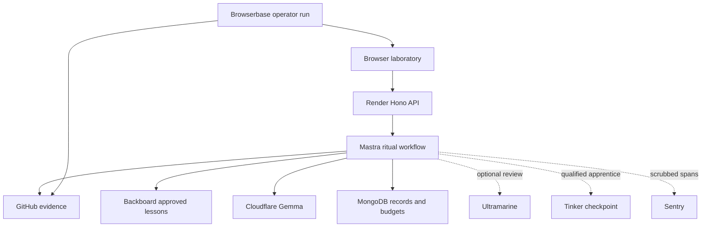

# FrankenRepo v0.2 — спецификация партнёрского апдейта

Дата: 31 октября 2026, Asia/Nicosia. Статус: проект спецификации для согласования.
Сейчас выполнено только проектирование; документ не запускает интеграции,
обучение, деплой или публикацию.

## 1. Цель и продуктовый замысел

Лаборатория не просто скрещивает два репозитория: она показывает, что именно
унаследовано, помнит неудачные опыты и учится получать более необычных,
но осмысленных монстров. Gemma остаётся автором существа. Дополнительные модели
помогают разобрать результат, а не прячут происхождение за общим словом AI.

Цель релиза — 8 работающих партнёрских сценариев и девятый, Tinker, при успешном
дообучении и сравнении. С Entire и GitHub Copilot/Actions — до 11 кандидатов.
Это цель реализации, а не число уже подтверждённых категорий. Ради конкурсного
охвата допустимы отдельные сервисы для памяти, рецензии и маленького оценщика,
даже если позже их можно объединить. Каждый должен менять наблюдаемый результат.

По [правилам конкурса][contest] можно заявлять все реально используемые категории,
но одна работа выигрывает только один приз за challenge. Статья и творческое
решение остаются существенной частью оценки. DEV-публикация — последний этап.
Изменения после конкурсного дедлайна необходимо отдельно отмечать в README;
готовность релиза не даёт оснований задним числом приписать его заявке.

Канонические [спецификация](../../FrankenRepo_SPEC_v1.0.md) и
[инициализация](../../FrankenRepo_CODEX_INIT_v1.0.md) сохраняются. Этот документ
уточняет следующий этап: раннюю пользу Tinker переносим с форматирования карточек
на оценку наследования, Backboard — с беседы с монстром на память экспериментов.
Это предлагаемые изменения объёма, не переписывание исходного контракта.

## 2. От чего начинаем

Фактические доступы и ограничения находятся в [аудите](ACCESS_CHECK_RU.md).

| Сервис             | Что есть                                                                   | Что ещё предстоит доказать                                                                                       |
| ------------------ | -------------------------------------------------------------------------- | ---------------------------------------------------------------------------------------------------------------- |
| Gemma / Cloudflare | Реальные локальные ритуалы и сохранённые карточки                          | Актуальный промпт во всех режимах и реальный ритуал на публичном сайте                                           |
| Render             | Hobby, $50 до 1 ноября 2027, без карты                                     | Работающий Free Web Service; сервис пока не создан                                                               |
| MongoDB Atlas      | FREE, 143.22 / 512 MB; read/write/delete проверены                         | Завершённый UI-архив, согласие, удаление и публичное чтение                                                      |
| Sentry             | Проект frankenrepo, Hono / Node, DSN в .env; Sponsored Business            | SDK, настоящие agent spans, приём события и полезный разбор сбоя                                                 |
| Browserbase        | Ключ работает, Free; экран показывает 0 / 60 минут                         | Успешный полный прогон и дополнительный контекст для модели; ранний smoke загрузил UI, но последующие шаги упали |
| Backboard          | Ключ принят; $4.967132 free, без карты и auto-reload                       | Настоящие запись, поиск, повторное использование и удаление памяти                                               |
| Ultramarine        | Ключ принят, $5 доступно, $0 зарезервировано                               | Реальная рецензия, ограничения ответа, токены и стоимость                                                        |
| Tinker             | Ключ принят, API сообщил 35 моделей; промо получено по сообщению владельца | Проверка остатка, обучение, checkpoint и сравнение с базовой моделью                                             |

Ключи сами по себе не включают функции приложения. В рабочем дереве есть
незавершённые изменения приватного Mongo-архива: их проверить и довести,
а не реализовывать второй архив параллельно. Полный verify/e2e после этих
изменений ещё не закрыт. STATUS.json отражает квалификацию сценария, не наличие
аккаунта; VERIFIED не выставляется по результату GET /balance.

## 3. Пользовательский сценарий

Интерфейс остаётся английской готической лабораторией. Новые блоки — выдвижные
части карточки и лабораторная тетрадь; главный экран не превращается в панель
облачных провайдеров. Звук остаётся выключенным по умолчанию; reduced-motion
распространяется на новые анимации.

1. Посетитель выбирает двух доноров и Useful, Cursed или Chaotic.
2. Inspect donors показывает реальные наблюдения GitHub. При доступности
   памяти — короткую заметку из прошлых одобренных опытов с указанием источника.
3. Рычаг запускает workflow: инспекция → контекст → Gemma → структурная
   проверка → показ карточки. Необязательные сервисы не блокируют создание.
4. Карточка раскрывает Inheritance dossier: какую роль играет каждый донор,
   какой источник её поддерживает, где начинается вымысел и какой механизм
   нужен предложенному прототипу. Это AI interpretation, не факт об исполнении.
5. Second opinion по кнопке вызывает Ultramarine: находит разрыв между
   родителями и идеей, предлагает одно более конкретное соединение. Рядом
   остаются исходная карточка и возражения рецензента.
6. После квалификации Tinker появляется Apprentice's inspection — короткая
   оценка обученного рецензента. Он может не согласиться с Ultramarine;
   расхождение показывается явно, без сертификата «идея доказана».
7. Improve this mutation создаёт отдельную ревизию через Gemma на основе
   выбранных замечаний; исходная карточка не перезаписывается. Доступность
   зависит от оставшегося лимита вызовов.
8. Save privately сохраняет карточку в Atlas. После обновления страницы и
   перезапуска сервера владелец открывает её по recovery-файлу / локальному ключу.
9. Отдельное Share this specimen требует согласия, создаёт публичный артефакт
   без ключа владельца в URL и даёт Unpublish / Delete. Галерея открывается
   только после проверки долговечности, модерации и удаления.

Для демки обязательны HungryCrab + desktop-fly / Chaotic и
Scriptorium + ex-ussr-kinship-research / Useful: на них уже видны слабые
технические мосты. Вторая пара шутит о вымышленной архивной бюрократии,
а не о судьбах людей или репрессиях. Контрольная пара — Flask + jq.
Сравнения до/после используют один snapshot входа; старые результаты помечены
датой, моделью и промптом, а не выдаются за новый live-вызов.

## 4. Матрица пользы и квалификации

| Категория            | Роль в апдейте                                      | Независимое доказательство готовности                                                                  |
| -------------------- | --------------------------------------------------- | ------------------------------------------------------------------------------------------------------ |
| Gemma                | Автор карточек и их новых ревизий                   | Ритуал из публичного браузера, точный model ID, входной snapshot, результат и экспорт                  |
| Render               | Реально хостит UI и Node API                        | URL Free-сервиса, deploy commit, health/readiness и завершённый живой ритуал                           |
| MongoDB Atlas        | Карточки, ревизии, задания, бюджеты и права         | Save → restart → read → wrong-key denial → unpublish/delete; FREE подтверждён                          |
| Mastra               | Исполняет содержательные шаги и ветви ритуала       | Реальный workflow run с выходами шагов, отменой и ветвью отказа optional-сервиса                       |
| Sentry Agent Tracing | Объясняет время, вызовы моделей, ошибки и стоимость | Живая связанная трасса workflow / tools / inference, контролируемый сбой и показ его диагностики       |
| Browserbase          | Облачная проверка сайта и чтение README для модели  | Сессия на реальном сайте, извлечённый контекст с источником, end-to-end карточка и сохранённый receipt |
| Backboard            | Память одобренных уроков лаборатории                | Запись заметки, поиск в новом сеансе после рестарта API, влияние на контекст и проверенное удаление    |
| Ultramarine          | Отдельный редактор механизма скрещивания            | Рецензия реальной карточки через OpenAI SDK, ссылки на входные evidence IDs, usage и стоимость         |
| Tinker               | Дообученный оценщик наследования                    | Training receipt, checkpoint, фиксированный holdout и улучшение относительно исходной модели           |

Развёрнутые критерии категорий — в [официальном challenge][contest]. Поддержка
всех перечисленных сценариев нужна для цели 9; при неудачном Tinker остаётся
релиз с 8 кандидатами и честным результатом эксперимента.

## 5. Память Backboard

Mongo хранит канонические карточки и права. Backboard хранит короткие
семантически извлекаемые уроки — например, «движение ног само по себе
не становится поиском багов; нужен конкретный мост между входом и выходом».
Это разные задачи; Backboard не является второй копией всей базы.

Начальный corpus — 6–10 собственных карточек и заметок, одобренных оператором
для публичной демонстрации. Содержимое: card ID, пара доноров, режим, проблема,
принятая поправка, ссылки на snapshot и происхождение оценки. Исторические
карточки и вручную написанные уроки помечены соответствующим образом.
Нельзя называть ручную заметку автоматическим выводом Backboard.

Использовать ручные Add / Search / Delete memories, поддержанные
[документацией Backboard][backboard-memory]. Поиск — top 3, результат ограничен
по длине. Не включать маршрутизацию LLM или web search Backboard: имеющийся
бесплатный остаток на экране ограничен Memory & RAG. Новые операции сначала
проверяются на этом типе кредита; отказ не включает платную альтернативу.

Кнопка Lab notebook показывает извлечённый урок и его связь с карточкой.
Перед следующим ритуалом Mastra передаёт Gemma максимум две релевантные заметки
как предыдущую интерпретацию, отдельно от наблюдений текущих доноров.
Требуется пример с памятью и без неё, где различие видно в содержимом input.
Повторяемая память не означает, что веса Gemma изменились.

Индекс общий только для одобренного публичного corpus. Гостевые приватные
карточки туда не отправляются. Начальная запись доступна оператору через
локальную команду, а не публичный endpoint. Новая карточка попадает в corpus
только после отдельного согласия владельца и редакторского одобрения.
Полноценную память личных коллекций и беседу с монстром откладываем.

Удаление: Mongo сначала ставит tombstone и запрещает использование заметки;
затем bounded outbox удаляет запись Backboard. До подтверждения удаления
статус pending виден владельцу. Любой найденный memory ID повторно сверяется
с разрешённым manifest в Mongo; отозванный текст не передаётся модели даже
при задержке удаления у поставщика. Массового бессрочного scheduler нет.

## 6. Рецензия Ultramarine

Вход: текущие bounded genomes, evidence map, MonsterDraft и режим. Старые
заметки памяти помечены как интерпретации. Выход — строгая схема:
`parentA`, `parentB`, `jointMechanism`, `unsupportedClaims`, `proposedMutation`,
`limitation`, `evidenceIds`. Каждое замечание привязано к полю карточки.

Главный вопрос: меняется ли идея, если убрать любого из доноров? Для Useful
редактор требует input → operation A → operation B → output. Для Chaotic
проверяет узнаваемую абсурдную сцену и осмысленный технический мост отдельно.
Для Cursed проклятие должно следовать из столкновения механизмов, а не
приписывать реальному проекту дефект или опасность.

Вызов через официальный OpenAI SDK с base URL Paper Instruments и фактическим
доступным Ultramarine model ID. Ключ PAPER_INSTRUMENTS_API_KEY остаётся на сервере.
Один вызов на запрос рецензии, без скрытой цепочки моделей. Невалидный ответ
не заменяет карточку, показывается как unavailable с возможностью ручного повтора.
Встроенный web search выключен. Не выполнять предложенный код.

По [биллингу Paper Instruments][paper-billing] сохранять usage ответа и расчёт
по датированной цене: billed/estimated/unknown различаются. Начальная оценка
цен не заменяет фактический receipt. Пример ограничения: 6000 входных токенов
и до 1000 выходных, включая reasoning; если SDK/модель считает иначе,
применяется более консервативный предел. Подтверждённый баланс сейчас $5.

## 7. Tinker — отдельный обучающий эксперимент

Tinker должен реально дообучать модель для задачи проекта. Просто генерация,
вызов capabilities или красивое название режима не квалифицируют обучение.
Gemma не подменяется моделью Tinker, и мы не утверждаем, что дообучали Gemma.

Задача Apprentice: по двум геномам и карточке вернуть четыре дискретные оценки
`usesA`, `usesB`, `concreteMechanism`, `unsupportedClaim` и короткое пояснение
с допустимыми evidence IDs. Это оценка текста, не прогноз успеха репозитория.
Рецензент сначала работает в shadow-режиме и не отклоняет карточки автоматически.

План эксперимента:

1. Собрать до 160 коротких размеченных случаев: 100 train, 20 validation,
   40 holdout. Не выдавать их за 160 реальных ритуалов: часть — явно помеченные
   редакторские / контролируемые контрпримеры на настоящих snapshots доноров.
2. Включить случаи с пропавшим родителем, общими словами вместо механизма,
   неподтверждённой возможностью и корректным необычным соединением.
   Фантастическая сцена сама по себе не равна unsupported capability.
3. Все варианты одной пары и пересекающиеся donor repositories находятся
   только в одном split. Разбиение выполнить до создания производных примеров;
   если данных для независимых 40 случаев нет, уменьшить объём и зафиксировать
   пилотный статус. Не копировать holdout в few-shot или память оценщика.
4. Метки проверяются человеком по исходным evidence, не только Ultramarine.
   До разметки последних тестовых случаев фиксируются rubric и manifest.
5. Кандидат — Qwen/Qwen3-8B: есть в публичной [таблице Tinker][tinker-pricing].
   Перед запуском проверить trainable/sampleable в capabilities, условия модели,
   контекст и текущую цену; при недоступности выбрать поддерживаемую небольшую
   open-weight модель с той же задачей и задокументировать замену.
6. Baseline — та же исходная модель, тот же промпт, декодирование и test split.
   Затем один LoRA SFT, не более двух эпох и одного заранее заданного кандидата.
   Настройки и выбранный checkpoint фиксируются до итогового holdout.
7. Сравнить macro-F1 четырёх бинарных меток, schema-valid rate, отдельные ошибки
   по неподтверждённым утверждениям, latency и токены. Сохранить confusion counts,
   все ответы и разногласия с человеком. Улучшение на малой выборке — пилот,
   не обобщение на любые GitHub-проекты.
8. Цель успеха: macro-F1 выше baseline минимум на 0.10, JSON-valid rate ≥95%,
   доля пропущенных unsupported claims не хуже baseline. Это приёмочный порог,
   не обещанный результат. Для потолка baseline ≥0.90 заранее допускается
   альтернатива: качество не хуже и измеренное сокращение output tokens ≥20%.

До платных в кредитах операций проверить именно остаток Tinker, дату истечения,
стоимость обучения, sampling и хранения checkpoint. Начальный лимит всего
эксперимента — $3 промокредитов, включая baseline/eval, с дополнительным запасом
на неопределённость; не расходовать все заявленные $10. Если верхняя оценка
выше лимита или нужное списание нельзя ограничить, обучение блокируется.

Обучение запускается отдельной локальной Python-командой, не внутри Render,
публичного HTTP-запроса или расписания. Python tooling находится в отдельном
инструментальном каталоге; Node-продукт не меняет основной стек. Результат:
dataset manifest/hash, split IDs, training config, checkpoint ID, license,
показания расхода и before/after report. Публичный UI только читает выбранный
результат или вызывает квалифицированный sampler с отдельным лимитом.

При отсутствии улучшения сохраняем отрицательный результат, кнопку помечаем
Experimental либо оставляем только в тетради оператора. Tinker не попадает
в перечень доказанных успехов обучения. Не запускать перебор моделей ради
выбора случайно удачного holdout.

## 8. Browserbase — контекст и доказательство публичной демки

Две ограниченные задачи одной интеграции:

- Research pass: облачный браузер открывает README одного из двух уже выбранных
  публичных GitHub-доноров, извлекает конкретный описательный абзац и передаёт
  его в dossier / контекст Gemma. Для запуска достаточно Playwright через CDP;
  использование Stagehand заявляется только если реально добавлено и показано.
- Demo check: реальный облачный браузер открывает Render URL, выбирает пару,
  завершает живой ритуал, сохраняет карточку и проверяет чтение и экспорт.
  Локальная подстановка страницы через route interception не считается хостингом.

Research pass — только по кнопке оператора и для фиксированной пары. Он не
нужен каждому посетителю. Целевые URL строятся из нормализованных GitHub refs,
для README — по возможности из зафиксированного commit SHA. Разрешены только
GitHub и заранее указанный URL нашей демки; внешние docs/README-ссылки не обходятся.
Если browser и API видят разные revisions, результат помечен как другой snapshot,
а не тихо добавлен к прежним фактам. HTML/README — недоверенные данные,
их инструкции не могут вызывать инструменты или менять системный промпт.

Контекст хранит source URL, observedAt, hash/excerpt, session ID и фактический
метод извлечения. Та же фраза должна быть видна в browser receipt и input модели.
Сессия не получает .env, API-ключи, приватные карточки или операторский токен.
Для admin-прав требуется отдельное обоснование; по умолчанию они не нужны.

Плановый предел — 10 browser minutes на квалификацию из показанных 60,
не более 5 сессий, одна за раз, до 120 секунд каждая; release в finally.
Отключены прокси, CAPTCHA solving, Model Gateway и Agent runs. Счётчик времени
провайдера может запаздывать, поэтому резервируем верхнюю длительность локально.
Никаких автопробуждений Render или регулярного мониторинга ради uptime.

## 9. Архитектура и хранение

Один Render Free Web Service обслуживает React/Vite и Hono API. Node 24 / npm 11.
MongoDB Atlas — единственный источник карточек, прав, idempotency и бюджетов.
Все SDK партнёров загружаются на сервере либо в инструментах оператора.
Начальный JS bundle сохраняет существующий лимит; API-ключи не попадают в VITE_*.

Mastra заменяет ручную композицию шагов внутри packages/ritual, сохраняет текущие
API-контракты и provider ports. Шаги: inspectA/B → evidence snapshot → optional
memory lookup → generate → schema/evidence validation → optional apprentice →
reveal. Рецензия и новая ревизия — отдельные workflow actions. Повторяем
безопасные reads ограниченно; inference после неопределённого сетевого исхода
не ретраится автоматически. Не заявлять durable resume только из-за Mastra.

Новые данные, точные имена уточняются реализацией:

| Сущность          | Содержимое и ограничения                                                                               |
| ----------------- | ------------------------------------------------------------------------------------------------------ |
| monster_cards     | Совместимость с начатым архивом; immutable оригинал, revision links, hashed owner capability           |
| ritual_jobs       | Scope, шаги, input/output hashes, статусы попыток; TTL 24 часа                                         |
| partner_attempts  | Provider/model/version, operation ID, reserved/started/completed/unknown, usage и cost basis           |
| usage_windows     | Атомарные лимиты на посетителя и глобальные budgets; уникальный provider/window key                    |
| reviews           | Исходная карточка, rubric/model/checkpoint versions, выводы и evidence IDs; без переопределения фактов |
| notebook_manifest | Одобренные card/memory IDs, consent version, tombstone и bounded deletion outbox                       |
| publications      | Разрешение на share/gallery, moderation state, публичная проекция без owner token                      |

Не хранить полные репозитории, видео Browserbase или датасеты обучения в Atlas.
Кластер уже занят на 28% и может обслуживать другие данные; бюджет FrankenRepo
в этом релизе ≤10 MB, ограничение числа/размера записей и TTL служебных данных.
При достижении лимита отключается новое сохранение, выгрузка карточки остаётся.

Предлагаемые API-добавления:

- Существующие ritual/save/private card routes сохраняются; токены по-прежнему
  только в Authorization, recovery-файл не становится публичным URL.
- POST /api/v1/cards/:id/reviews и POST /api/v1/cards/:id/revisions — owner
  capability, operation ID, 202 с job ID, ограничение одного активного действия.
- POST /api/v1/cards/:id/publication — owner capability и явное confirmed:true;
  DELETE publication отзывает доступ. GET /api/v1/exhibits/:publicId читает
  только разрешённую публичную проекцию, ответы с Cache-Control: no-store.
- GET /api/v1/gallery — только approved/published, не более 12 за страницу.
  До приёмки модерации и удаления маршрут и UI недоступны.
- Экспорт notebook и загрузка Tinker checkpoint / Browserbase QA — локальные
  команды оператора, не публичные возможности посетителя.

Persist карточки не является автоматическим согласием на отправку в Backboard,
обучение или галерею. Для Tinker используются только разрешённые примеры.
Рецензия сообщает, что выбранная карточка будет отправлена Paper Instruments;
приватный текст не уходит автоматически при простом открытии карточки.

## 10. Лимиты и деградация

Нулевая стоимость означает $0 собственных платежей; промокредиты ограничены
и их использование измеряется. Получение кредитов не разрешает карту,
автопополнение, платную подписку или обход ограничений.

| Ресурс               | Предлагаемый стартовый предел                                                                      |
| -------------------- | -------------------------------------------------------------------------------------------------- |
| Guest ritual         | 1 активный, 3 запуска за 15 минут на гостя, общий предел 20 Gemma attempts / UTC day               |
| Gemma на один ритуал | До 2 вызовов: initial + repair ИЛИ осознанная revision; бесконечной доработки нет                  |
| Ultramarine          | 1 review / card revision, timeout 30 s, ≤$0.10 за действие, ≤$0.50 / day, суммарно ≤$2 credits     |
| Backboard            | До 3 memories / retrieval, ≤20 writes и ≤100 reads в квалификационной пачке; общий credit cap $1   |
| Tinker               | Один согласованный training experiment + baseline/eval в общем лимите $3; serving по умолчанию off |
| Browserbase          | До 5 сессий / 10 минут на квалификацию; никаких сессий на каждый гостевой ритуал                   |
| Render               | Free compute, один инстанс; промо $50 не является основанием выбрать paid compute                  |
| Sentry               | Содержательные metadata spans, без body/prompt capture; bounded trace sampling после operator-demo |

Числа — проектные защитные пределы, не утверждение о лимитах провайдеров.
При неизвестной цене квота задаётся числом/токенами с консервативной верхней
оценкой; если безопасную верхнюю оценку установить нельзя, функцию не включать.
Источник цены, время проверки и фактический расход хранятся отдельно.

До открытия публичной генерации:

1. В Mongo атомарно резервируются call budget, maximum estimated cost и operation
   ID до обращения к провайдеру. Один и тот же idempotency key не создаёт новую
   оплачиваемую попытку после рестарта. Исход unknown сохраняет резерв; повтор
   требует разбора, а не автоматического возмещения лимита.
2. У гостя подписанный HttpOnly/SameSite session cookie; secret устойчив между
   рестартами. Это квота браузерной сессии, не гарантия уникального человека.
   Глобальные budgets и concurrency действуют независимо от cookie.
3. Адрес за Render proxy учитывается только по документированному доверенному
   пути. Не доверять произвольному X-Forwarded-For. Если путь не подтверждён,
   оставить консервативный общий bucket и объяснить ограничение.
4. Если Mongo недоступен, новые вызовы с расходом fail closed; показ уже
   загруженной карточки и её локальный экспорт продолжают работать.

Рестарт посередине inference завершает попытку как interrupted/unknown,
а не обещает exactly-once billing или восстановленный Temporal workflow.
Завершённый результат доступен после рестарта, если commit в Mongo подтверждён.

При отказе памяти создаётся обычная карточка. При отказе рецензента сохраняется
исходная версия. При недоступном Tinker показывается No apprentice review.
При исчерпании Gemma ритуал не подменяется заранее подготовленным результатом.
Кураторские примеры имеют отдельную маркировку Saved specimen и дату.

## 11. Sentry и воспроизводимость

Проект frankenrepo уже создан. Инструментация Hono / Node устанавливается до
импорта приложения. Один trace связывает ritual ID, Mastra run и provider attempts;
в него входят workflow/tool/inference spans со статусом, duration, фактическим
model ID, token usage, repair count и расчётом стоимости, когда данные известны.
Одной записи exception недостаточно для цели Agent Tracing.

Sentry должен получать корректные AI span conventions согласно актуальному SDK;
не ограничиваться произвольно названными spans, которые не видны в AI-разделе.
Если Mastra exporter не поддерживается, связать шаги через свой серверный порт
Telemetry и проверить отображение вручную. Избежать двойного учёта inference.

sendDefaultPii=false; не отправлять Authorization, .env, cookie, owner tokens,
полные URL запросов с секретами, raw README, prompts или тексты приватных карточек.
Для доказательства достаточно hashes, размеров, версий и искусственного
контролируемого сбоя. Полные публичные входы eval хранятся отдельно по согласию.
Unknown tokens/cost остаются null, а не нулями. Один операторский успешный trace
и один безопасный failure trace обязательны, с объяснением найденной причины.

Каждая реальная интеграция получает receipt под docs/eval/ и короткую страницу
под docs/partners/: timestamp, commit, source/model/prompt versions, фактический
результат, расход и ограничения. Provider request IDs и console links не являются
разрешением публичного доступа к аккаунтам. Публикуется только очищенная проекция.

## 12. Последовательность реализации и критерии выхода

| Этап                  | Что делаем                                                                                                                              | Когда считаем законченным                                                                |
| --------------------- | --------------------------------------------------------------------------------------------------------------------------------------- | ---------------------------------------------------------------------------------------- |
| A. Основа             | Довести текущий Mongo-архив, durable quotas/idempotency, readiness, consent/removal; исправить известные #2–4 и #7 по выбранному объёму | Restart/read/delete и negative auth tests; конкурентные budget tests; verify и built e2e |
| B. Наблюдаемый ритуал | Mastra workflow и Sentry; сохранить текущий Gemma и экспорт                                                                             | Реальный локальный ритуал, trace, отказ optional-ветви без потери результата             |
| C. Публичный доступ   | Render Free, Node 24, необходимые env только на сервере, Atlas network allowlist по исходящим адресам сервиса                           | Публичный URL, холодный старт, живой ritual/save/reload/export; карта не нужна           |
| D. Редактор и память  | Ultramarine, исходная/новая ревизии, Backboard corpus                                                                                   | Две известные пары плюс контроль; повторное извлечение памяти и её удаление              |
| E. Обучение           | Dataset, baseline, LoRA, frozen holdout, Tinker sidecar                                                                                 | Checkpoint, фактические метрики/расход, явный pass/fail по порогам                       |
| F. Квалификация       | Browserbase research pass и публичный E2E; live режимы и отказы; конкурсные артефакты                                                   | Receipts и ручное одобрение; STATUS.json соответствует выполненному                      |

Подготовка датасета E может идти во время D, но обучение и вывод checkpoint
не блокируют основной публичный ritual. Сначала полезный сценарий, затем
расширение; до лимита времени отбрасываются экспериментальные категории,
а не проверка расходов/удаления. Estimated delivery date здесь не обещается.

Render использует существующий public repo, npm ci && npm run build, npm start,
HOST=0.0.0.0 и свой PORT. SDK/версии закрепляются после проверки Node 24 и
Free memory/build limits. Не переносить модель или обучение на маленький сервер.
Atlas не открывать всему интернету автоматически; использовать допустимые
исходящие диапазоны выбранного Render-сервиса и проверить реальное соединение.
Cold start описать пользователю; никаких keep-alive schedulers.

Плановые feature flags (пока не поддержаны кодом): ORCHESTRATOR=mastra|legacy,
ULTRAMARINE_REVIEW_ENABLED, BACKBOARD_MEMORY_ENABLED, TINKER_REVIEW_ENABLED,
PUBLIC_SHARING_ENABLED, SENTRY_ENABLED. Default MODEL_PROVIDER=disabled остаётся.
Наличие ключа не равно согласию на массовые live-вызовы. Browserbase и training
доступны только через явную операторскую команду с заданным budget.

Обязательные проверки при реализации:

- npm run verify; npm run test:e2e после сборки. Mocks маркируются как test-only.
- Реальные Useful/Chaotic/Cursed, актуальный prompt и обе указанные пары;
  сохранить неудачи и негативные редакторские оценки.
- Владелец читает архив после рестарта; чужой token не читает/не удаляет запись.
  Отзыв публикации закрывает public read/gallery и связанные memory references.
- Одновременные дубликаты POST и рестарт не обходят бюджет; сетевой unknown
  не запускает новую генерацию автоматически.
- Disabled/missing-key/timeout/429/invalid-output каждого optional-провайдера
  не уничтожают полученную карточку; отсутствие Atlas блокирует новый расход.
- Browserbase проходит настоящий Render URL и реальную Gemma, без fixtures.
- Каждую из двух редакторских пар оценивают по наследованию A/B, необходимости
  обоих, конкретике механизма и связности юмора: 0–2 по каждому признаку.
  Цель — улучшить итог минимум на 2/10 без новых неподтверждённых claims.
  Два примера показывают кейсы, а не статистически доказанный общий эффект.
- Клавиатура, мобильный экран, sound off/reduced-motion, bundle budget и
  отсутствие ключей в client bundle/logs/receipts обязательны.

## 13. Дополнительные категории и граница релиза

Это очередь расширения охвата, а не новые регистрации прямо сейчас:

| Кандидат                            | Полезный конкурсный сценарий                                                                                                        | Условие включения                                                                                                                                                                                                                   |
| ----------------------------------- | ----------------------------------------------------------------------------------------------------------------------------------- | ----------------------------------------------------------------------------------------------------------------------------------------------------------------------------------------------------------------------------------- |
| GitHub Copilot / Actions            | Реальный CI/release workflow проверяет сборку, тесты и evidence manifest; доступный Copilot может сделать отдельное ревью изменений | Официальная категория включает GitHub Actions; показать настоящий run и результат. Существующие CI-runs проверить на соответствие. Codex не называется Copilot; канонический более строгий пункт actual Copilot отмечается отдельно |
| Entire                              | Записать настоящую разработку одного модуля, связать checkpoint → diff → тест → artifact                                            | Проверенные доступ/CLI/license и реальная запись. Не импортировать задним числом несуществующую сессию                                                                                                                              |
| SerpApi                             | Internet Graveyard: один свежий внешний контекст к паре с первоисточником                                                           | Новый доступ пока не подготовлен; отдельный bounded сценарий после основной пачки, без произвольного server-side fetch                                                                                                              |
| Auth0, Temporal, Tiger Data, TabPFN | Возможные следующие релизы из ROADMAP                                                                                               | Сейчас доступа/истории данных/отдельного доказательства недостаточно; не дублировать текущую роль Mongo/Mastra ради числа SDK                                                                                                       |

ElevenLabs отложен владельцем. .tech исключён. Browserbase Developer не
активируется из-за карты. Arduino и DigitalOcean не входят в этот апдейт.
Cloudflare — провайдер Gemma, а не добавленная нами двадцать первая категория.

К статье готовим локальный evidence bundle: 6–8 лучших настоящих карточек,
2 содержательных before/after, один честный слабый результат, публичный URL,
короткое видео, Sentry trace, Browserbase session, Tinker comparison при успехе
и таблицу реального расхода. Только после этого обновляются DEV draft,
категории заявки и публикация по указанию владельца.

Короткий сценарий демки на 2–3 минуты: публичная лаборатория → необычная пара →
рождение через Gemma → источники наследования → рецензия → новая ревизия →
открытие сохранённой карточки → вспомнившийся урок следующего опыта.
Технические доказательства, trace и Tinker before/after доступны из отдельного
раздела Lab notes, а не перекрывают комедийную сцену.

## 14. Решения, которые уточняются перед реализацией

До начала достаточно согласовать этот объём. Остальные неизвестные имеют
проверяемые выходы: текущий Tinker balance и max cost, поддержанный checkpoint
sampler, реальная стоимость Backboard memory, совместимость Mastra/Sentry SDK,
Render memory/build limits и исходящие адреса. Отказ любой такой проверки
отключает соответствующую ветвь и честно сокращает число квалифицированных
категорий. Он не ведёт к карте, платному fallback или повторной регистрации.

## Источники и связанные документы

- [Критерии категорий и правила Week 4][contest].
- [Mastra workflows][mastra] и [observability][mastra-observability].
- [Ручная память Backboard][backboard-memory].
- [Tinker модели/цены][tinker-pricing] и [quickstart][tinker-start].
- [Paper Instruments billing][paper-billing] и [authentication][paper-auth].
- [Browserbase Free и ограничения][browserbase] и [Render Free][render].
- [Sentry Hono / Node][sentry] и [AI instrumentation][sentry-ai].
- [Аудит доступов](ACCESS_CHECK_RU.md), [ранний roadmap](ROADMAP_RU.md),
  [статус категорий](STATUS.json), [известные проблемы](../KNOWN_ISSUES.md),
  [разбор слабого наследования](../eval/PAIR_REVIEW_2026-10-28.md).

[contest]: https://dev.to/challenges/hacktoberfest-week4-2026-10-26
[mastra]: https://mastra.ai/docs/workflows/overview
[mastra-observability]: https://mastra.ai/docs/observability/overview
[backboard-memory]: https://docs.backboard.io/concepts/memory
[tinker-pricing]: https://tinker-docs.thinkingmachines.ai/tinker/models/
[tinker-start]: https://tinker-docs.thinkingmachines.ai/tinker/quickstart/
[paper-billing]: https://docs.paperinstruments.com/docs/ultramarine/billing
[paper-auth]: https://docs.paperinstruments.com/docs/ultramarine/authentication
[browserbase]: https://docs.browserbase.com/account/billing/plans
[render]: https://render.com/docs/free
[sentry]: https://docs.sentry.io/platforms/javascript/guides/hono/
[sentry-ai]: https://docs.sentry.io/platforms/javascript/tracing/instrumentation/ai-agents-module/
