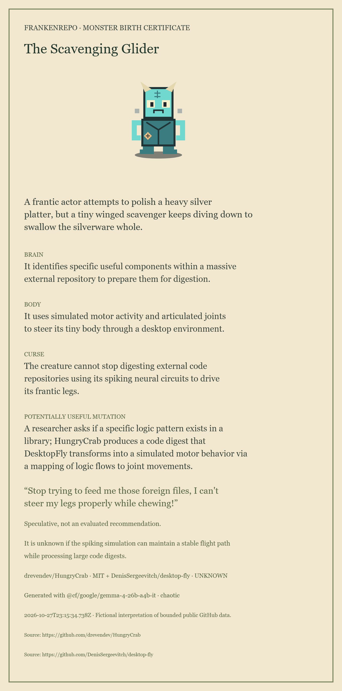

# I Gave Two GitHub Repositories a Terrible Idea. Then I Gave It Life.

**WORKING DRAFT — not publish-ready. Local Cursed and Useful/Chaotic Gemma results
are verified; public hosting and a final walkthrough remain unverified.**

The idea is small: choose two public repositories, borrow a little of their
observable DNA, and ask an open-weight model to imagine their extremely
questionable offspring. A gothic laboratory turns the result into a creature
and a downloadable birth certificate.

## What works locally today

The lab accepts two public GitHub references and collects a bounded set of
source-linked observations. It never runs donor code. Missing observations stay
unknown. The original SVG creature kit has deterministic parts, the interface
supports keyboard and reduced motion, and certificate export is browser-tested
using explicit fixtures and dated real Cloudflare Gemma runs. Real inputs include
Flask/jq, HungryCrab/DesktopFly and Scriptorium/kinship; see ../eval/REAL_RUNS.md for unchanged output,
observed commits and saved PNG/SVG evidence.

## The first real spark

On 28 October 2026 (Asia/Nicosia), Cloudflare @cf/google/gemma-4-26b-a4b-it
generated The JSON-Wrapped Serpent of Pallets from the actual public donors,
through the browser and local API. Its first words were “Behold the beast of
the command line!” The response passed strict JSON and source-ID validation.
The measured browser verification flow, including inspection and exports, took
8.258 seconds after browser launch. This is not provider-only model latency.

The saved receipt preserves the unchanged draft and model/prompt ID. A hosted
weight digest and provider usage counters were not captured. Both donor domains
are recognizable, but the useful mutation is broad and hyperbolic. This is one
structurally valid sample, not a creative-quality benchmark. Six subsequent
Useful/Chaotic runs compare prompt versions v1/v2/v3; see
../eval/INHERITANCE_REVIEW.md. The latest prompt makes Flask route requests and
jq transform JSON, while Chaotic adds an absurd waiter/ghost scene. The technical
idea remains modest, and the captioned demonstration still needs recording.

## A repository-eating fly and a suspicious archivist

The more personal pair was HungryCrab, which distills other repositories into
digests, and DesktopFly, whose simulated motor activity moves an articulated fly.
In Chaotic mode Gemma first invented a bug-finding insect. It was funny, but the
sources did not explain how a walking simulation would detect bugs. Passing the
JSON schema was clearly not enough.

After tightening the prompt, The Scavenging Glider complained: “Stop trying to
feed me those foreign files, I can't steer my legs properly while chewing!”
Now the joke grew from both parents. The proposed mapping from a digest to motor
behavior remained vague, so I kept the card as a comic character and marked its
technical idea as unfinished.

Scriptorium and ex-USSR Kinship Research produced The Archivist of Lost Verses:
a creature worried that a metaphor might be a relative. That is a useful comic
image for the article, but its claim about measuring poetic sentiment was not in
the source excerpt. Literary measurements and source registers cannot establish
feelings or family relationships. The [pair review](../eval/PAIR_REVIEW_2026-10-28.md)
keeps the attractive parts and the mistakes visible. The
[editorial shortlist](EDITORIAL_SELECTION.md) supplies exact assets, captions and
separately labelled prototype ideas for the next round.

The lesson is part of the product: unusual parents can create a memorable
personality, while a meaningful prototype still needs a specific bridge between
their actual operations. A new prompt is an experiment, not a quality guarantee.

## A real failure learned during implementation

The first production browser test loaded a blank page: the origin allowlist
included the development UI but omitted the API's own static-site origin.
The app consequently denied its own JS and CSS. An origin regression check and
browser rerun were added after correcting the local production allowlist.

## Partner proof

Verified locally: **Gemma**, supported by ../partners/gemma.md and its real
browser receipt. Public deployment is not verified; Render and other categories
must not be claimed on this evidence.
The complete twenty-category state is ../partners/STATUS.json.
A Codex coding session is not evidence of GitHub Copilot use.

## Why open innovation

Public source evidence can inspire new ideas without copying or executing source
code. A locally runnable, open application makes the boundary between repository
facts and creative fiction inspectable. Portfolio principles inspired bounded
inspection and honest unknowns; original code/assets were written for this app.

## Limitations and publication checklist

No permanent storage, public gallery, deployment or independent-user walkthrough
has been verified. Several real model artifacts exist, but no replay mode is offered.
The owner reports Workers Free; no billing changes were made. Neuron usage and
the billing dashboard were not captured, so measured cost is not claimed.
Per-process limits do not establish an unlimited free hosted service.

Owner must add the authorized live/repository URLs, real 45–60s captioned
walkthrough, actual failure/model learning, working quickstart and only verified
partner categories, then verify the contest's current rules and eligibility.
No publication was attempted. Challenge deadline in owner spec:
31 October 2026, 23:59 PDT / 1 November 2026, 08:59 Asia/Nicosia.
